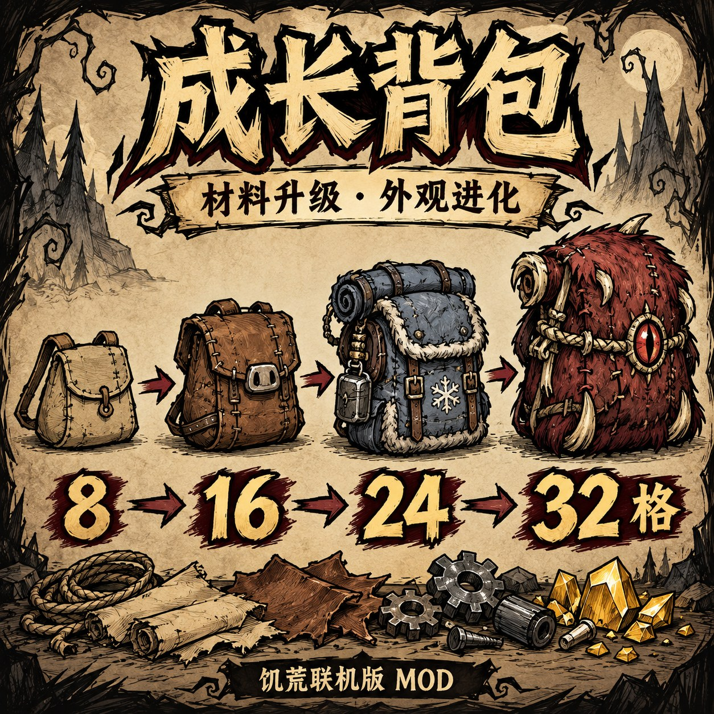

# 成长背包（材料扩容）

《饥荒联机版》服务器模组，版本 **1.3.1**。同一个背包随材料投入逐级扩容：**8 → 16 → 24 → 32 格**；机械档起还可另装食物保鲜插件，远古档可另装返鲜插件。

[Steam 创意工坊](https://steamcommunity.com/sharedfiles/filedetails/?id=3822024875) · [公开源码](https://github.com/NewBoyIsBusy/growing-backpack) · [安装包下载](https://github.com/NewBoyIsBusy/growing-backpack/releases/tag/v1.3.1)

Steam 工坊仅好友可见；GitHub 源码和版本下载公开。



封面为 AI 生成的宣传示意，非游戏截图。

## 制作与扩容

在制作栏的“容器”分类制作成长背包、扩容工具与功能插件。

| 物品 | 配方 | 科技要求 | 用途 |
| --- | --- | --- | --- |
| 成长背包 | 草 ×4、树枝 ×4 | 科学机器 | 初始 8 格 |
| 皮革扩容工具 | 绳子 ×2、猪皮 ×2、金块 ×2 | 科学机器 | 8 → 16 格 |
| 机械扩容工具 | 蜘蛛丝 ×4、莎草纸 ×2、齿轮 ×2 | 炼金引擎 | 16 → 24 格 |
| 远古扩容工具 | 铥矿 ×4、黄宝石 ×2、噩梦燃料 ×4 | 完整远古伪科学站 | 24 → 32 格 |
| 保鲜插件 | 齿轮 ×2、蓝宝石 ×1、电子元件 ×2 | 炼金引擎 | 机械档及以上可装 |
| 返鲜插件 | 铥矿 ×6、绿宝石 ×2、噩梦燃料 ×6 | 完整远古伪科学站 | 远古档可装 |

远古扩容工具与返鲜插件均需每次在完整远古伪科学站旁制作，无法解锁后离站制作。

1. 把成长背包脱下并放到地上，不用清空包内物品。
2. 用鼠标拿起对应工具，指向**地上的背包实体**。
3. 扩容工具执行“扩容背包”，功能插件执行“安装背包插件”（左右键均支持）。成功后消耗一个工具，在原背包上完成改变。

容量必须逐级升级，无法跳级。错误档位、已满级扩容、等级不足、重复安装及穿戴中的背包不会消耗工具。把工具拖到已打开的物品格里仍是普通存放；升级或安装请点击地上的背包。此前存入的工具可取出继续使用。

等级和插件记录在背包自身，换人携带不会重置。扩容及存取档保留插件与原物品；旧版本已有背包无需重新制作，新插件需另行制作安装。背包名称和检查信息显示容量及已安装插件。

## 保鲜与返鲜

两种插件独立安装，可在同一只背包上共存，返鲜效果优先。远古背包可以直接安装返鲜插件，无需保鲜插件作为前置。

- **保鲜插件**：机械档（24 格）起可装。食物腐败倍率为 **0.625**，即原版冰箱减缓腐败幅度的 75%。它既不是 0.75 倍腐败速度，也不是再乘上一层冰箱效果。
- **返鲜插件**：远古档（32 格）可装。背包内食物暂停正常腐败，每游戏日恢复 **25 个百分点**的新鲜度，按 0→100% 需 **4 游戏日**的速度返鲜，满新鲜度后停止增长。腐烂物以及新鲜度已经到 0% 的食物无法复原。
- 只影响可食用且会腐败的物品。原本暂停腐败的食品保持暂停状态，不会强制开启其计时器。
- 返鲜每 10 秒更新一次，支持游戏模拟跳时；关服期间的现实时间不计入游戏日。

未安装插件时没有保鲜或返鲜效果。原版普通背包、猪皮包、坎普斯背包保持原版行为。

## 外观与界面

| 容量 | 背包外观 |
| --- | --- |
| 8 格 | 缝补布包 |
| 16 格 | 灰粉猪皮行囊，带卷猪尾巴 |
| 24 格 | 发条机械背包：双孔钥匙、大弹簧、褐色铆钉外壳与圆镜片 |
| 32 格 | 铥矿远古背包：橙黄色块、方形回纹与黑色刻线 |


四档统一使用粗黑线、歪斜轮廓和少量平涂色，升级时同步切换地面、穿戴、物品栏及地图造型。1.3.0 将穿戴视角单独绘制，以原版背包的肩带和各方向符号布局接入；原有大幅图集仅保留地面造型与图标来源。沿用原版背包动画，无需购买皮肤。

三种扩容工具和两种功能插件都有独立地面造型、制作栏与库存图标。所有物品图标使用 **64×64 像素**并保留透明边距。


- **每页 8 格**：8/16/24/32 格分别为 1/2/3/4 页，扩容增加页数。界面保持原版普通背包的大小，不再一次铺开全部格子。
- **独立背包模式**使用原版 2 列 × 4 行木框；**整合背包模式**使用原版两行物品栏布局，其中背包一行显示当前页的 8 格。
- 点击原版左右箭头翻页，页码显示当前位置；手柄在当前页的横向边界继续移动可翻页。物品图标与格子保持原版尺寸。
- 分页只改变显示：所有已解锁格子仍可存放物品、正常联网同步，并持续参与已安装插件的保鲜或返鲜。无需清空、重做或重新升级已有背包。

## 安装

完全退出游戏，解压 `growing_backpack_v1.3.1.zip`，把整个 `growing_backpack` 文件夹放入 `Don't Starve Together/mods/`；结构应为 `mods/growing_backpack/modinfo.lua`。更新时覆盖旧模组文件，再重新启动游戏。Steam 订阅用户使用工坊更新。

房主在世界设置的“模组 → 服务器模组”中启用“成长背包（材料扩容）”。**房主和所有玩家均需安装同一版本**；本地 ZIP 不会自动向好友分发。可用于已有世界。

专用服务器在地面和洞穴的 `modoverrides.lua` 中都启用对应模组。手动安装版条目为：

```lua
["growing_backpack"] = { enabled = true },
```

将条目合并到现有 `return { ... }` 表中，工坊安装使用对应 `workshop-3822024875` 条目。

背包占用身体装备栏，不提供加速、防水或防火效果，仍然可燃；烧毁时按原版背包方式掉落物品。关闭或卸载模组前请先移出包内物品，禁用新增物品模组后自定义物品无法正常载入。

## 构建与验证

安装包包含四组 `gb_pack_0..3`、三组 `gb_upgrade_1..3`、`gb_preservation_kit` 和 `gb_freshness_kit` 的动画 ZIP 与 XML/TEX 图标，以及运行所需 Lua。GitHub 另外保留透明 PNG、提示词和构建脚本，玩家无需安装美术工具。

在仓库根目录重建美术，需 Python 3.10+、Pillow 与 Steam 的 Don't Starve Mod Tools：

```powershell
python tools/build_art.py --work-dir ../.tools/art_build
python tools/build_kit_art.py --work-dir ../.tools/kit_art_build
```

工具默认查找本机 D 盘 Steam Mod Tools，可用 `--mod-tools` 指定其 `mod_tools` 目录。背包原图为 `assets/source/gb_pack_N.png`，穿戴视角为 `gb_pack_N-worn.png`；工具源图按预制物名命名。官方编译后执行 BC3 解码校验。

从工作区（仓库上一级）运行回归脚本：

```powershell
python growing_backpack/tests/run_checks.py
python growing_backpack/tests/run_client_checks.py
python growing_backpack/tests/run_inventory_layout_checks.py
python growing_backpack/tests/run_foodmodule_checks.py
python growing_backpack/tests/run_game_smoke.py
```

Lua 检查使用 `lupa.lua51`，优先读取工作区 `.tools/lua_test_runtime`。客户端、界面与食物回归运行原版游戏相关 Lua，使用模拟实体、网络变量和控件依赖；原版脚本默认位于 `game_scripts_reference/scripts`，可用 `DST_SCRIPTS_PATH` 指定。界面检查需覆盖两种背包模式下的分页显示、物品格与真实库存编号的对应、手柄导航及容器复用；食物回归检查安装条件、腐败倍率、返鲜速度、优先级与存档状态。

引擎脚本创建独立离线测试世界与临时模组，结束后移除临时模组并保留工作区日志。专用服务器与模拟检查不等同于真人客户端画面、完整多人联机或跨洞穴迁移验收。原版游戏脚本和测试世界不包含在安装包内。

工坊包使用普通文件，不含 Klei 文件清单，`modinfo.lua` 需保留 `forcemanifest = false`。本版本继续保留客户端容器初始化、格子网络监听和明确升级动作的既有修复。

美术均由内置 `image_gen` 生成或编辑。最终源图、提示词与旧稿的对应关系见 [美术源文件说明](assets/source/README.txt)；穿戴稿使用 `gb_pack_N-worn-prompt.txt`，工具使用对应 `*-prompt.txt`。源图与提示词仅在 GitHub 源码保留，Steam 和 ZIP 使用编译资源。封面提示词为 `assets/cover-prompt.txt`，原图为 `assets/workshop-cover.png`，工坊使用 `assets/workshop-preview.jpg`。
